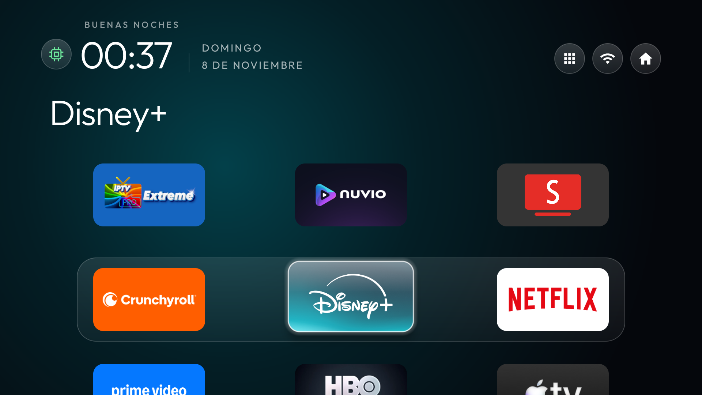

# CleanYourTV Streamer

**Proyecto original de [Gathin23 (Gathin)](https://github.com/Gathin23) y los colaboradores de [CleanYourTV](https://github.com/Gathin23/cleanyourtv).** Este repositorio recoge las modificaciones que hicimos sobre [CleanYourTV v3.4.0](https://github.com/Gathin23/cleanyourtv/tree/v3.4.0) para dispositivos Android TV y Google TV. Incluye el parche completo del launcher, el tema de tres columnas y el monitor de reposo. Cada persona compila y firma su propia instalación.

- Tema oscuro, banda de cristal que sigue la fila seleccionada y nombre de la app fijo al navegar.
- Cajón de apps a la izquierda del Wi-Fi y accesos superiores con iconos.
- Limpieza opcional de procesos en caché al entrar en reposo. Al despertar, Inicio muestra durante cinco segundos un recuadro con el número de apps cerradas y la variación aproximada de RAM disponible.
- Chip junto al reloj. Verde si la limpieza está activa. Gris si está desactivada o no se puede verificar. Permite reactivarla con el mando tras reiniciar.

## Antes y después

| Inicio original de Google TV | CleanYourTV con los añadidos |
| --- | --- |
|  |  |

La imagen del Inicio original es una referencia oficial de Google TV. [Fuente de la imagen](https://tv.google/)

- [Vídeo de navegación y cajón de apps](demostracion-navegacion.mp4?raw=1)
- [Vídeo del aviso de RAM](demostracion-aviso.mp4?raw=1), grabado al mostrar de nuevo el resultado real de la prueba de reposo.
- [Captura del cajón](cajon.png) · [Captura del aviso tras el reposo](aviso.png) · [Tiempos de respuesta y método](MEDICIONES.md)

## Compatibilidad

| Dispositivo | Recursos | Estado |
| --- | --- | --- |
| Google TV Streamer (4K), `kirkwood` | 4 GB de RAM, 32 GB de almacenamiento | Probado en Android 14, compilación `UTTK.260317.003`, con reinicio completo, reactivación local, reposo y aviso. |
| Chromecast con Google TV (4K), `sabrina` | 2 GB de RAM, 8 GB de almacenamiento | Probado en Android 14, compilación `UTTC.250917.004`, con reinicio, reactivación del chip y aviso al salir de reposo. El firmware necesitó reactivar la depuración inalámbrica tras reiniciar. |
| Wanbo Cube 1, `BOS` | 1 GB de RAM, Mali-G31, 720p | [Tema ligero y guía de diagnóstico](perfiles/wanbo-cube-1/README.md) para `HP4703-Skyworth`, comprobado antes y después de actualizar de Android 11 a 14. |
| Philips UHD 2020/2021, `PH0M_EA_T32` | 1,32 GiB de RAM utilizables, MediaTek `m7332`, Mali-G52 | [Perfil Philips](perfiles/philips-ph0m-ea-t32/README.md) probado en Android TV 11, compilación `200715`, con dos filas de cuatro, inicio tras reinicio y Shizuku para ObtainX. |

[Ficha del Streamer](https://store.google.com/product/google_tv_streamer_specs) · [Ficha del Chromecast](https://support.google.com/chromecast/answer/12578818) · [Desmontaje del Chromecast 4K](https://www.techinsights.com/products/ddt-2010-818) · [Notas de firmware](https://support.google.com/chromecast/answer/7124014)

## Preparar y compilar

Necesitas Git, Python 3, JDK 17, Android SDK Platform 34, Build Tools 34.0.0 y [Platform Tools](https://developer.android.com/tools/releases/platform-tools). La primera compilación descarga las dependencias de Gradle. Configura `JAVA_HOME`, `ANDROID_HOME` y deja `adb` en el PATH.

```sh
python prepare.py
cd upstream/launcher
./gradlew assembleRelease
```

En PowerShell, usa `py -3 prepare.py` y `.\gradlew.bat assembleRelease`. El APK queda en `upstream/launcher/app/build/outputs/apk/release/app-release.apk`.

## Instalar el launcher y el tema

Desde la raíz del repositorio, conecta y autoriza tu equipo siguiendo la [guía oficial de ADB](https://developer.android.com/tools/adb#connect-to-a-device-over-wi-fi). En los ejemplos, sustituye `<dispositivo>` por el identificador exacto de `adb devices`.

```sh
adb -s "<dispositivo>" install -r --user 0 upstream/launcher/app/build/outputs/apk/release/app-release.apk
adb -s "<dispositivo>" shell am start -a android.intent.action.MAIN -c android.intent.category.HOME -n com.gathin.tvhome/.MainActivity
```

Si tenías CleanYourTV firmado con otra clave, Android rechazará la actualización. Guarda tu tema y ajustes antes de decidir si sustituyes esa instalación. Conserva en privado tu clave local de firma para las siguientes actualizaciones.

El perfil [Streamer oscuro](config.json) rellena las filas con las apps disponibles. Puedes indicar el orden de tus apps en `dock_apps`, poner utilidades en el cajón con `hidden_apps` y excluir accesos duplicados con `library_excluded_apps`. Aplica el tema con la [herramienta original](https://github.com/Gathin23/cleanyourtv/blob/v3.4.0/themes/README.md) y pasa la carpeta que contiene `config.json`. La herramienta tiene versiones para Bash y PowerShell.

Para que abra con el mando, elige CleanYourTV en el selector de Inicio si tu firmware lo ofrece. Consulta [Inicio, limpieza de paquetes y reversión](INSTALACION-AVANZADA.md) si Google TV conserva su launcher predeterminado.

## Activar la limpieza en reposo

```sh
python monitor.py --device "<dispositivo>" install
python monitor.py --device "<dispositivo>" inspect
```

Pulsa el **chip gris** junto al reloj. Autoriza a CleanYourTV cuando Android muestre su huella de depuración. La conexión la hace el propio Streamer. Al reiniciar por completo, vuelve a pulsar el chip. Si tu firmware apaga la depuración o revoca la autorización, Android puede pedir que la vuelvas a activar o autorizar. Para probar el Chromecast 4K en Android 14, añade `--experimental` y comprueba primero el resultado de `inspect`.

El monitor espera la señal de reposo y considera solo apps de usuario que Android mantiene en caché. La cifra de RAM compara la memoria disponible antes y después de la operación. Android también administra esa memoria por su cuenta, por lo que la cifra puede variar. Algunos arranques de apps serán en frío después de la limpieza. La limpieza está desactivada inicialmente en este paquete.

El permiso de red del launcher permite abrir la conexión de depuración a `127.0.0.1`, dentro del propio dispositivo. La identidad de esa conexión se genera y se guarda en los datos privados de la app. La comprobación de estado se hace al entrar en Inicio, despertar o enfocar el chip.

Para apagar la función, pulsa el chip verde y elige **Desactivar**. Para retirar el monitor de esa sesión usa `python monitor.py --device "<dispositivo>" stop`. Mantén la depuración habilitada únicamente mientras la necesites y autoriza conexiones solo en una red de confianza.

## Créditos

Basado en [CleanYourTV](https://github.com/Gathin23/cleanyourtv) de Gathin y sus colaboradores. El parche conserva su licencia MIT. La compilación incluye [libadb-android](https://github.com/MuntashirAkon/libadb-android) y [Bouncy Castle](https://www.bouncycastle.org/), con sus licencias respectivas.
