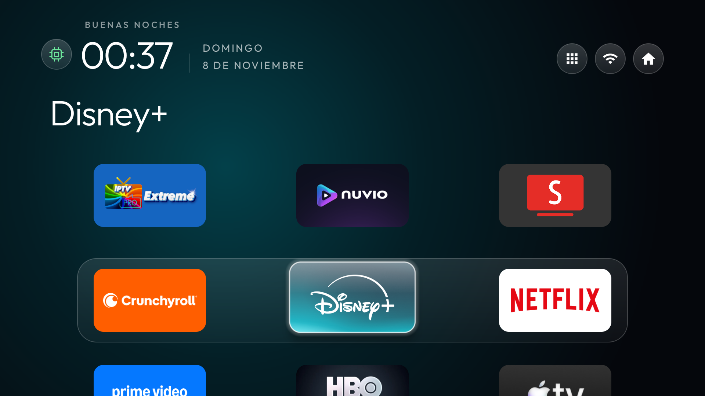

# Google TV Streamer (4K)

La unidad de prueba se identificó como `kirkwood` y ejecutaba Android 14, compilación `UTTK.260317.003`. Google especifica 4 GB de RAM, 32 GB de almacenamiento, salida hasta 4K HDR a 60 Hz, Wi-Fi ac y Ethernet gigabit. [Ficha de Google](https://store.google.com/es/product/google_tv_streamer_specs?hl=es)

## Configuración probada

Se usó el [tema de tres columnas](../../config.json) con la banda de cristal siguiendo la fila seleccionada, el cajón a la izquierda del Wi-Fi y el chip de limpieza junto al reloj. AIDA64, X-plore y Button Mapper se dejaron como utilidades. Se comprobó Inicio nativo con el mando, el volumen y los accesos habituales.

Para repetir la instalación, sigue la [guía del launcher y del tema](../../README.md#instalar-el-launcher-y-el-tema). El cambio a Inicio nativo en el firmware probado incluyó desactivar el launcher de Google y SetupWraith. Es una operación opcional: guarda el estado inicial, comprueba quién creó la red Wi-Fi y verifica Cast si lo utilizas. La [guía de reversión](../../INSTALACION-AVANZADA.md) explica cómo restaurar el Inicio original y los paquetes cambiados.

## Mediciones

| Medida con AIDA64 2.26 y CleanYourTV | Resultado |
| --- | ---: |
| Apertura de AIDA64 en frío, mediana de 5 | 659 ms |
| Vuelta de AIDA64 a Inicio, mediana de 5 | 202 ms |
| Apertura de Inicio en frío, mediana de 3 | 568 ms |
| RAM disponible al tomar la muestra | 1.873.020 KiB |
| Espacio libre en `/data` al tomar la muestra | 20 GiB aprox. |

Los tiempos son `WaitTime` de Android en una sesión de comparación con el [Chromecast 4K](../chromecast-google-tv-4k/README.md). La memoria y el espacio libre dependen de las apps instaladas y abiertas. Hay otra sesión en [MEDICIONES.md](../../MEDICIONES.md) que compara revisiones del launcher y registra los tiempos por fotograma.

## Reposo y actualización de apps

Tras un reinicio completo, el chip gris permitió reactivar el monitor desde el propio Streamer. En el siguiente reposo se cerraron cinco apps en caché y la RAM disponible aumentó aproximadamente 13 MB. El aviso apareció durante cinco segundos. [Captura del aviso](../../aviso.png)

Se instaló ObtainX con comprobaciones cada seis horas y se añadieron las fuentes de Nuvio, SmartTube e IPTV Extreme Pro. Se comprobó que Android registró el trabajo en segundo plano. La instalación automática de una futura actualización puede depender del firmware y de la confirmación que solicite Android.
