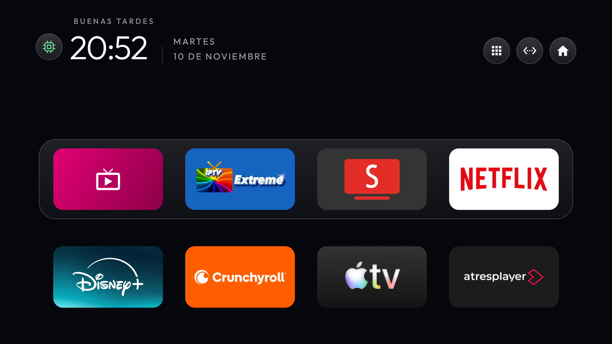

# Philips UHD 2020/2021 (`PH0M_EA_T32`)

Perfil de CleanYourTV para la Philips identificada por Android como «2020/2021 UHD Android TV». La unidad probada usa Android TV 11 de 32 bits (API 30, `armeabi-v7a`), compilación `RTM2.210929.098` con revisión `200715`, MediaTek `m7332` de cuatro núcleos hasta 1,55 GHz y Mali-G52. Android dispone de 1,32 GiB de RAM y una partición `/data` de 4,00 GiB. El lienzo del launcher es de 1920 × 1080. Comprueba la placa y la compilación antes de reutilizar los ajustes.

El [tema](config.json) tiene dos filas de cuatro, fondo oscuro y movimiento reducido. La ficha magenta abre la TV nativa de MediaTek. El cajón guarda Button Mapper, AIDA64, X-plore, ObtainX y Shizuku. El mando abre Ajustes, Entradas y Play Store mediante sus botones y atajos. Play Store sigue instalada y se excluye del cajón mediante `library_excluded_apps`.



| Fila | 1 | 2 | 3 | 4 |
| --- | --- | --- | --- | --- |
| 1 | TV en directo | IPTV Extreme | SmartTube | Netflix |
| 2 | Disney+ | Crunchyroll | Apple TV | Atresplayer |

## Conexión e instalación

En la unidad probada, activar la depuración habilitó ADB en el puerto 5555. Conecta en una red de confianza con `adb connect <IP-de-la-TV>:5555`, acepta la huella en la tele y usa el identificador que devuelve `adb devices`. Comprueba que `getprop ro.product.device` devuelve `PH0M_EA_T32` y `getprop ro.build.version.incremental` devuelve `200715`.

1. Prepara el código con `python prepare.py` desde la raíz del proyecto y aplica el [parche Philips](philips.patch) sobre el árbol recién preparado.

   ```sh
   git -C upstream apply --check ../perfiles/philips-ph0m-ea-t32/philips.patch
   git -C upstream apply ../perfiles/philips-ph0m-ea-t32/philips.patch
   ```

2. Compila, firma y aplica este tema con la [guía del proyecto](../../README.md#instalar-el-launcher-y-el-tema). El parche conserva el código de versión 11 de la instalación Philips probada para poder volver a su APK anterior firmado con la misma clave. Android rechazará actualizar si la firma difiere o si ya hay instalado un código superior.
3. Prueba CleanYourTV y la ficha TV en directo. Guarda el componente HOME y los estados originales antes de cambiar Inicio o desactivar paquetes. En esta unidad se asignó CleanYourTV como HOME y se desactivó el launcher original de Google tras probar el acceso. La [guía de reversión](../../INSTALACION-AVANZADA.md#volver-atrás) explica cómo recuperar el estado registrado.

## Limpieza y reposo

En esta Philips se desactivaron paquetes concretos de diagnósticos, promociones y configuración inicial por tandas. También se desactivó el salvapantallas y se redujeron las animaciones. La lista se eligió a partir del inventario de esta unidad. Antes de repetir la limpieza, verifica los paquetes en tu compilación y conserva los servicios de TV, HDMI, sonido, mando, Cast, DRM y Play Store. [Ejemplo de limpieza para esta placa en CleanYourTV](https://github.com/Gathin23/cleanyourtv/tree/v3.4.0/examples/philips-50pud7406).

El [monitor Philips](cleanyourtv-standby.sh) usa la señal de pantalla de este firmware. Solo considera las siete apps multimedia de la cuadrícula cuando Android las mantiene en caché. Deja TV en directo fuera de la lista. En una prueba cerró Atresplayer al entrar en reposo y la memoria disponible pasó de 554 120 a 611 180 KiB, unos 56 MiB de diferencia en esa sesión. El aviso aparece al volver a Inicio.

## Shizuku y ObtainX

En esta unidad se usaron [Shizuku 13.6.0](https://github.com/RikkaApps/Shizuku/releases/tag/v13.6.0) y [ObtainX](https://github.com/bikram-agarwal/ObtainX) para configurar actualizaciones de SmartTube Stable (`armeabi-v7a`) e IPTV Extreme normal. El [archivo de fuentes](obtainx-fuentes.json) contiene los dos canales. Se seleccionó Shizuku como instalador, se autorizó solo a ObtainX y se configuró la comprobación cada hora con instalación en segundo plano. Se comprobó la configuración y el reinicio de Shizuku. Quedó pendiente observar la llegada e instalación automática de una versión nueva.

Si quieres reproducir la recuperación local, instala Shizuku y aplica el parche Philips. En la placa y compilación verificadas, copia los dos scripts desde la raíz del repositorio a la TV autorizada.

```sh
adb -s "<dispositivo>" push perfiles/philips-ph0m-ea-t32/cleanyourtv-standby.sh /data/local/tmp/cleanyourtv-standby.sh
adb -s "<dispositivo>" push perfiles/philips-ph0m-ea-t32/recuperar-shizuku.sh /data/local/tmp/cyt-shizuku-recovery.sh
adb -s "<dispositivo>" shell 'sh -n /data/local/tmp/cleanyourtv-standby.sh && sh -n /data/local/tmp/cyt-shizuku-recovery.sh && chmod 700 /data/local/tmp/cleanyourtv-standby.sh /data/local/tmp/cyt-shizuku-recovery.sh'
```

Pulsa el chip de RAM de CleanYourTV y acepta el aviso de Android para autorizar su conexión ADB local. Si la activación manual es necesaria, abre el chip y elige **Reactivar servicios**. Se comprobó que tras un reinicio completo volvieron CleanYourTV, el monitor y Shizuku. El firmware abrió primero TV en directo y el launcher tomó el primer plano después. Con el monitor activo también volvió a Inicio al despertar desde TV en directo. La recuperación necesita que ADB siga habilitado y que su autorización local se conserve. Para equipos anteriores o con otra arquitectura, consulta las [opciones de arranque de Shizuku](../../INSTALACION-AVANZADA.md#actualizar-apps-con-obtainx-y-shizuku).

## Medición con CleanYourTV

Lecturas pasivas durante el uso normal de la tele, sin cambiar de app ni enviar pulsaciones. Tres muestras de memoria separadas por unos tres segundos.

| Medida | Resultado |
| --- | ---: |
| RAM atribuida al launcher (PSS), mediana de 3 | 27,5 MiB |
| RAM disponible del sistema, mediana de 3 | 632,3 MiB |
| Espacio libre en `/data` | 1,38 GiB |
| Tiempo de dibujo por fotograma, percentil 95 | 65 ms |
| Fotogramas con retraso según Android | 60 de 301 (19,9 %) |

Las muestras PSS fueron 25 183, 28 147 y 28 146 KiB. Las de RAM disponible fueron 649 492, 647 420 y 647 424 KiB. Los fotogramas proceden de los contadores acumulados del launcher y no corresponden a una secuencia de navegación controlada ni a la reproducción de vídeo. Los resultados describen el estado actual. Falta la prueba de apertura en frío de AIDA64 2.26 y una medición equivalente con el inicio original. [Método de referencia del proyecto](../../MEDICIONES.md) · [Documentación de `dumpsys`](https://developer.android.com/tools/dumpsys#gfxinfo).
