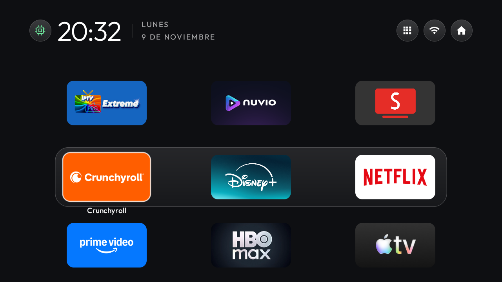

# Wanbo Cube 1

Perfil ligero de CleanYourTV para el proyector Wanbo Cube 1. La [ficha de Wanbo](https://wanbo.cn/pages/wanbo-projector-cube-1) indica Android TV 11, Widevine L1, HDMI, enfoque eléctrico y corrección trapezoidal de cuatro puntos.

La unidad identificada usa una plataforma Amlogic de Skyworth, producto `HP4703-Skyworth`, dispositivo `BOS`. Tiene 1 GB de RAM, GPU Mali-G31, Android TV 11 de 32 bits (API 30) y salida de 1280 × 720. La compilación observada es `RTT0.210829.002.P2.1.6_20240930`. Comprueba estos datos antes de reutilizar los ajustes en otro proyector.

El [tema actualizado](config.json) muestra tres filas y una banda de cristal que se desplaza a la fila seleccionada. Usa animaciones básicas y mantiene apagados los efectos avanzados, el fondo de imagen, el resplandor y los módulos. El cajón queda a la izquierda del Wi-Fi y reúne Button Mapper, ObtainX, AIDA64 y Play Store. Las nueve apps de Inicio no se duplican en el cajón. El acceso de Ajustes del proyector se mantiene en el mando.



La captura corresponde al perfil visual probado en Android 14. Para que se vea el desplazamiento de la banda en esta unidad, se dejó `animator_duration_scale` en `0.5`. Los efectos avanzados siguen desactivados.

| Fila | Izquierda | Centro | Derecha |
| --- | --- | --- | --- |
| 1 | IPTV Extreme Pro | Nuvio | SmartTube |
| 2 | Crunchyroll | Disney+ | Netflix |
| 3 | Prime Video | HBO Max | Apple TV |

Instala las apps que uses por sus canales oficiales. En este Wanbo, Play Store suministró HBO Max `22.0.0.36` con API mínima 29. La variante del mismo número de versión instalada en el Streamer requería API 32. La selección de la tienda permitió instalar la variante compatible con Android TV 11.

## Conexión e inventario

En la unidad probada, activar **Depuración USB** abrió ADB por la red local en el puerto 5555. Conecta el proyector y el ordenador a tu red de confianza, ejecuta `adb connect <IP-del-proyector>:5555` y acepta el aviso de Android en el proyector. La ficha de Wanbo describe el puerto USB exterior para almacenamiento. Comprueba que `adb devices -l` muestre el proyector como `device` antes de continuar. Sustituye `<dispositivo>` por su identificador.

```sh
adb -s "<dispositivo>" shell getprop ro.product.model
adb -s "<dispositivo>" shell getprop ro.product.device
adb -s "<dispositivo>" shell getprop ro.build.display.id
adb -s "<dispositivo>" shell cat /proc/meminfo
adb -s "<dispositivo>" shell df -h /data
adb -s "<dispositivo>" shell cmd package resolve-activity --brief -a android.intent.action.MAIN -c android.intent.category.HOME
adb -s "<dispositivo>" shell pm list packages -d --user 0
```

## Orden de las pruebas

1. Guarda el estado inicial fuera del repositorio. Mide la apertura de Inicio y de una app de prueba, la RAM disponible y el espacio libre. Aplica el tema y repite las mediciones en las mismas condiciones.
2. Instala CleanYourTV y aplica este tema con la [guía del proyecto](../../README.md#instalar-el-launcher-y-el-tema). Prueba CleanYourTV como app antes de asignarlo al botón Inicio. Comprueba el mando, el acceso a ajustes, el enfoque, la corrección trapezoidal, HDMI, Wi-Fi, audio y la reproducción protegida.
3. Revisa las apps opcionales y sus procesos en el firmware detectado. Registra el estado original de cada paquete y comprueba el equipo tras cada cambio. Consulta la [guía de reversión](../../INSTALACION-AVANZADA.md).
4. Comprueba el arranque completo. En la unidad actualizada a Android 14 se verificó que el chip puede reactivar el monitor de reposo y quedar verde. El monitor es opcional y se reactiva después de un reinicio completo si lo necesitas.

## Cambios probados

El Inicio original de Android TV tiene prioridad 2. En la prueba, `cmd package set-home-activity` devolvió éxito mientras Inicio seguía abriendo el launcher original. Tras verificar CleanYourTV en pantalla y como actividad HOME disponible, desactivamos `com.google.android.tvlauncher`, asignamos `com.gathin.tvhome/.MainActivity` y comprobamos la vuelta a Inicio desde Ajustes y tras reiniciar.

Tras probar el nuevo Inicio, se quitaron para el usuario 0 los paquetes de la tabla. Para las apps de sistema que tenían una actualización en `/data`, se retiró además esa actualización del paquete concreto. La copia original de cada app de sistema permanece en el firmware y se puede recuperar. En el equipo probado se recuperaron unos **243 MiB** con la limpieza, con las nueve apps de streaming ya instaladas.

| Paquete desinstalado | Función |
| --- | --- |
| `com.esaba.downloader` | Downloader |
| `com.google.android.videos` | Play Películas |
| `com.google.android.play.games` | Play Juegos |
| `com.google.android.feedback` | Envío de comentarios |
| `com.google.android.tvrecommendations` | Recomendaciones y promociones del Inicio original |
| `com.google.android.youtube.tvmusic` | YouTube Music |
| `com.google.android.youtube.tv` | YouTube, sustituido en Inicio por SmartTube |
| `com.google.android.tvlauncher` | Inicio original, retirado después de probar CleanYourTV |

Para recuperar una app de sistema, ejecuta `adb -s "<dispositivo>" shell cmd package install-existing --user 0 <paquete>` y `adb -s "<dispositivo>" shell pm default-state --user 0 <paquete>`. Para restaurar el Inicio original, recupera primero el launcher y sus recomendaciones, luego selecciona `com.google.android.tvlauncher/.MainActivity`. Downloader se puede reinstalar desde Play Store. El asistente de configuración, Play Services, el receptor Cast, el emparejamiento Bluetooth y los servicios del proyector se dejaron habilitados.

Durante la medición inicial, las tres escalas de animación pasaron de 0,5 a 0. En el perfil visual posterior se recuperó `animator_duration_scale=0.5` y se conservaron las transiciones de ventanas y actividades en 0. El salvapantallas de Android se desactivó con `settings put secure screensaver_enabled 0`. Guarda tus valores originales con `settings get` antes de aplicar estos cambios para poder recuperarlos.

## Mantener la pantalla encendida

Este ajuste es opcional. En la unidad probada, Android tenía un temporizador de pantalla de 15 minutos. `adb -s "<dispositivo>" shell svc power stayon ac` mantiene la pantalla activa mientras recibe alimentación de CA. Se comprobó la pantalla encendida pasados 23 segundos con un límite temporal de 10 segundos. El límite se devolvió a 15 minutos tras la prueba. Para volver al comportamiento de fábrica observado, usa `adb -s "<dispositivo>" shell svc power stayon false`. [Documentación de reposo en Android TV](https://source.android.com/docs/core/power/tv-standby).

## Medición antes y después

| Prueba | Inicio original | CleanYourTV y limpieza |
| --- | ---: | ---: |
| Apertura de Inicio en frío, mediana de 3 | 1868 ms | 640 ms |
| Volver de AIDA64 a Inicio, mediana de 5 | 469 ms | 625 ms |
| Apertura de AIDA64 2.26 en frío, mediana de 5 | 2152 ms | 1514 ms |
| RAM proporcional del launcher (PSS), mediana de 3 | 117 MiB | 58 MiB |
| RAM disponible del sistema, mediana de 3 | 233 MiB | 313 MiB |

Tiempos de `WaitTime` con `am start -W` en la misma unidad. Se detuvo el proceso de la app para cada apertura en frío. Las muestras de RAM se tomaron en Inicio tras cerrar AIDA64. Las cifras reflejan el conjunto de cambios de este perfil y el estado de Android durante la prueba. El retorno desde AIDA64 fue más lento y variable en la prueba final. Las cinco muestras finales fueron 625, 958, 103, 627 y 111 ms.

## Actualización a Android 14

El último reinicio aplicó una actualización pendiente a Android 14, compilación `UKG3.251130.001.C1.6.4_20260723`. El proyector mostró temporalmente un aviso de actualización y se reinició por sí solo. Al terminar, arrancó en CleanYourTV, conservó las nueve apps, mantuvo retirados los paquetes de la limpieza y siguió con la pantalla activa mientras recibe corriente. Quedaron unos 2 GiB libres en `/data`. Las mediciones de la tabla se hicieron antes de esa actualización, con Android 11.
